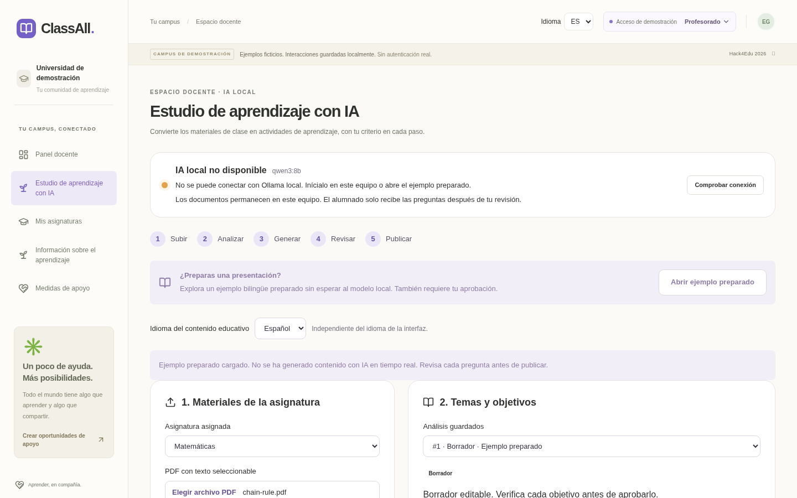

# ClassAll V4 implementation report

The feature branch is `feature/classall-multilingual-ai-studio`, based on merged
connected learning `91e1a10` from `main`. The original workspace branch was the
older MVP; implementation uses the newer main baseline. No public deployment or
merge is part of this change.

## User interface and internationalization

- Professor navigation now includes **AI Learning Studio / Estudio de aprendizaje
  con IA**. The existing typography, purple/sage palette and shell are retained.
- The workflow is Upload → Analyze → Generate → Review → Publish, followed by
  assignment to an existing compatible tutoring session. Later panels appear when
  their prerequisite document/analysis/assessment exists. Source passages expand
  on demand; slow requests have explicit progress, connection and recovery states.
- Professors upload a course PDF, choose page passages, edit proposed topics,
  concepts, summaries and objectives, approve objectives, and request small
  structured pre/post batches. Questions expose editable wording, options, correct
  answer, explanation, objective and difficulty alongside source inspection.
- Individual approval, rejection, optimistic revision checks, approval reset on
  edit, explicit complete-pair publication, and new draft revisions are persistent.
- Headers on both landing/application pages offer EN/ES. A small React
  `useSyncExternalStore` translation layer updates without reload, saves
  `classall.language`, sets the document language and uses a shared Spanish
  catalog. Date/time formatting follows EN/ES and the device time zone.
- Translation covers navigation for all roles, dashboards, booking flows,
  validation, Pulse, groups, Learning Checks, insights/actions and landing content.
  Native form validation and the visible PDF file picker are localized too.
  Course-card links wrap with longer Spanish text at tablet widths.
- Interface language and content language are separate. Source passages and
  user-written session/group titles, descriptions, answers and professor edits
  are retained in their original language. Published questions keep their approved
  language. All six original curated banks have equivalent Spanish prompts,
  options and explanations with stable question/option identity and ordering.

### Interface previews



[Tablet preview](previews/studio-tablet.png) · [Mobile preview](previews/studio-mobile.png)

## Local AI and PDF processing

`backend/app/ai.py` defines the `AIProvider` protocol, environment-based
`AISettings`, and `OllamaProvider`. FastAPI alone communicates with Ollama's
`/api/tags` and `/api/chat`. There is no frontend Ollama request, external AI
provider, key requirement or paid service.

The structured request includes the Pydantic JSON schema, `stream: false`,
`think: false` by default, model `qwen3:8b`, temperature, `num_ctx` and
`num_predict`. Source passages are JSON data and are explicitly described as
untrusted evidence in the system instructions. Prompt/schema/output budgets are
bounded before inference. Connection failures, missing models, timeout, malformed
JSON/schema output and truncation return recoverable errors. No partial output is
published. Cloud tests use fake providers or HTTPX mock transports.

PDF uploads allow 8 MB, 1–40 pages, verified extension/MIME/PDF signature, and
unencrypted text-based documents. A bounded ASGI upload middleware checks declared
and streamed body sizes before multipart parsing can spool an oversized request.
`pypdf` extracts text locally; excessive page streams/text and unreadable scans are
rejected. Each page is split into at most 900-character passages with stable IDs.
Selected context is limited to three passages/2700 characters, plus the stricter
provider prompt budget. Uploaded file handles are closed; filenames never become
filesystem paths. PDF bytes and extracted content are stored in local SQLite.

Schema validation requires distinct options, exactly one valid correct index,
nonempty fields, valid language/difficulty, unique question wording, equal-size
pre/post sets, the same objective coverage and comparable declared difficulty.
Service validation additionally requires approved objective IDs, requested count,
matching language/difficulty, and existing references within the selected source.
These structural checks **do not establish academic correctness**. Professors must
check the reasoning, sources and answer. Neither set is presented as
psychometrically validated.

## API additions

All `/api/studio` routes use the existing fictional demo actor and assigned-course
checks. These demonstrate role/ownership rules; they are not real authentication.

| Method | Route | Behavior |
| --- | --- | --- |
| GET | `/api/studio/status` | Local model status, mode, model tag and upload limits |
| GET | `/api/studio/workspace` | Assigned courses, owned documents/analyses/assessments, publications and candidate sessions |
| POST | `/api/studio/documents` | Bounded multipart PDF upload and extraction; `subject_id` + `file` |
| GET | `/api/studio/documents/{id}` | Owned document metadata and page passages, without local paths |
| GET | `/api/studio/demo/pdf` | Original redistributable synthetic PDF |
| POST | `/api/studio/demo?language=en\|es` | Explicit prepared document/analysis/question drafts; no inference |
| POST | `/api/studio/documents/{id}/analyze` | Live structured analysis of selected passages |
| PUT | `/api/studio/analyses/{id}` | Save edited topics/concepts/summaries/objectives and explicit review |
| POST | `/api/studio/assessments` | Generate a small complete pre/post draft pair from approved objectives |
| GET | `/api/studio/assessments/{id}` | Owned draft with question statuses and referenced passages |
| PUT | `/api/studio/assessments/{id}/questions/{question}` | Edit with optimistic revision check; reset to draft |
| POST | `/api/studio/assessments/{id}/questions/{question}/review` | Approve, reject or return to draft with revision check |
| POST | `/api/studio/assessments/{id}/publish` | Validate the whole reviewed pair; store immutable publication |
| POST | `/api/studio/assessments/{id}/revise` | Copy to a new, unreviewed draft version |
| POST | `/api/studio/publications/{id}/assign` | Transactionally assign to an upcoming same-course/topic session |

Existing GET/POST `/api/bookings/{booking}/learning-checks/{pre|post}` accept
`language=en|es`, defaulting to English. Responses include course/topic, content
language and provenance. Both submission and subsequent retrieval return compatible
metadata. A publication's approved language takes precedence over the query.

## Additive database structures

| Table | Purpose |
| --- | --- |
| `studio_documents` | Owner, course, safe display filename, SHA-256, page count, date and original PDF bytes |
| `studio_passages` | Stable passage ID, document, page, within-page order and extracted text |
| `studio_analyses` | Document, language, live/prepared mode, editable structured content, review status and date |
| `studio_assessments` | Owner, document, analysis, existing topic, language/mode, objective snapshot, status and revision |
| `studio_questions` | Assessment, validated structured question content, draft/review/rejection status and revision |
| `studio_publications` | One immutable JSON snapshot per published assessment, topic, language/mode, owner and timestamp |
| `studio_check_sources` | Original Learning Check ID → immutable publication provenance |

Migrations create these tables repeatably without rewriting legacy bookings,
questions, submissions, responses or dates. No existing table is dropped and no
reset is required. The prepared example appends drafts; it never initializes by
clearing existing user interactions.

Publication snapshots include objective descriptions, question content, correct
indices, citations, source excerpts and review state. Published questions cannot
be edited via the API; revisions receive new assessment/question IDs and start as
drafts. The shared provider/schema/review/snapshot components can support future
subject-knowledge content. No tutor certification or automatic qualification is
introduced.

## Integration with existing learning flows

Assignment materializes the reviewed snapshot into the original Learning Check,
question and answer-option tables. It retains publication provenance and maps
objectives into the existing topic/objective model. Assignment requires the owned
publication and a compatible assigned-course topic. It rejects sessions containing
any previous submission or an existing Studio assignment, protecting saved
responses and interpretations. Choose a new session for new versions.

The original server scoring, one-time submission, ownership, post-session readiness,
explicit completion simulation, histories and professor suppression rules are
reused. Correct answers and explanations are withheld until the corresponding
submission; locked post questions are withheld entirely. A saved result still
refers to the same immutable content after revision, cancellation and restart.

New tutoring sessions now obtain their default questions directly from the original
curated bank. Previously they copied another session's questions; with Studio
assignments that could silently copy a publication without provenance. A regression
test verifies that modifying an existing session's question content cannot change
new sessions' curated fallback. Studio content reaches a session by explicit
professor assignment.

Professor aggregates retain the existing distinct-learner/latest-confirmed-booking
logic and n<3 suppression. They are descriptive and may involve different content
versions; matching declared difficulty does not prove equivalence or causal impact.

## Verification performed in Cloud

All databases used by automated integration tests are isolated temporary files.
The repository's original tests remain and pass.

| Check | Result |
| --- | --- |
| Backend pytest | **98 passed**, including the original 58 tests |
| React/Vitest | **21 passed** across five files, including the original tests |
| React → real HTTP API → SQLite integration | Booking, scoring/readiness/history, Pulse/groups/tutor/faculty publishing, plus Studio edit/review/publication |
| TypeScript + production Vite build | Passed via `npm run build` |
| Original Chromium journey | Passed all workflows and 54 role/route/viewport checks |
| Spanish Chromium journey | Passed PDF upload, language reload persistence, question editing, review/publication, assignment and learner scoring; 57 role/route/viewport checks |
| Widths | 390, 768 and 1440 pixels; Studio populated review screens checked at each width |
| Browser exceptions | None in either journey |
| Translation coverage | Every literal `t`/`tr` interface key has a Spanish catalog entry |
| New Python source hygiene | Selected import/unused-name/modernization checks passed; files formatted |
| Whitespace | `git diff --check` passed |

New backend coverage includes invalid/oversized/streamed/encrypted/scanned PDFs,
page limits, extraction and source metadata, professor/course/document ownership,
mocked analysis/generation, unknown model citations/objectives, request language,
malformed structured content, duplicate options/questions, incorrect indices,
pre/post objective/difficulty pairing, connection/model/timeout/truncation failures,
prompt budget, edit/review conflicts, approval reset, unreviewed publication
prevention, immutable revisions, assignment, answer secrecy, scoring, readiness,
history, multilingual curated content and repeated migration/demo preservation.

New React coverage includes instant language switching, persistent preference,
translated role navigation and accessibility labels, localized date conventions,
dynamic explanatory messages, native validation language changes, full catalog
coverage and editing/approving/publishing prepared content through SQLite.

Reproduce from the repository root with an activated virtual environment:

```sh
python -m pytest backend/tests -q
npm test --prefix frontend
npm run build --prefix frontend
npm run test:browser --prefix frontend
```

`CLASSALL_PYTHON` selects an alternate Python executable for integration/browser
tests; `CLASSALL_CHROMIUM` selects an installed Chromium. Otherwise the scripts use
root `.venv` and Playwright's installed browser. Linux Cloud used the work virtual
environment and `/usr/bin/chromium`. Browser screenshots/logs are local ignored
artifacts under `work/browser-qa`. Backend tests emit one upstream Starlette/AnyIO
BlockingPortal deprecation warning; there are no test failures.

## Windows verification and remaining limits

**Real Ollama inference and Intel Arc GPU testing on the user's Windows laptop
remain outstanding.** No live local-model or GPU performance claim is made from
Cloud. The reported Ollama version, model, GPU utilization and ~18 tokens/second
were supplied target-environment observations.

README documents every configuration variable/default, PowerShell launch commands,
model/API verification and upgrade without deleting the database. `docs/V4_DEMO.md`
contains the bilingual presentation sequence and a ten-step Windows procedure,
including EN/ES live generation, small batches, academic/source review, recording
wall time/`ollama ps`, assignment/scoring, stopping/restarting Ollama, and confirming
that browser traffic never calls Ollama directly.

This remains a fictional local prototype: demo headers are spoofable; there is no
production authentication, encrypted local storage, OCR, malware execution sandbox,
durable generation job queue or validated academic assessment. Leaving a page
aborts its browser request but may not terminate Ollama's already-running inference.
A valid citation/schema is not proof of correctness. Public deployment and automatic
merging are excluded.
