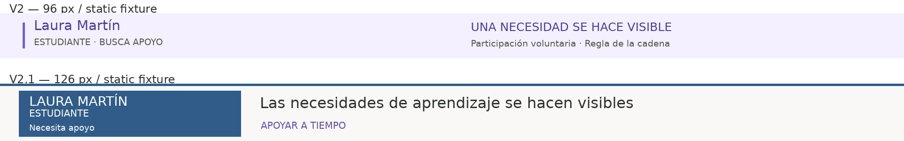
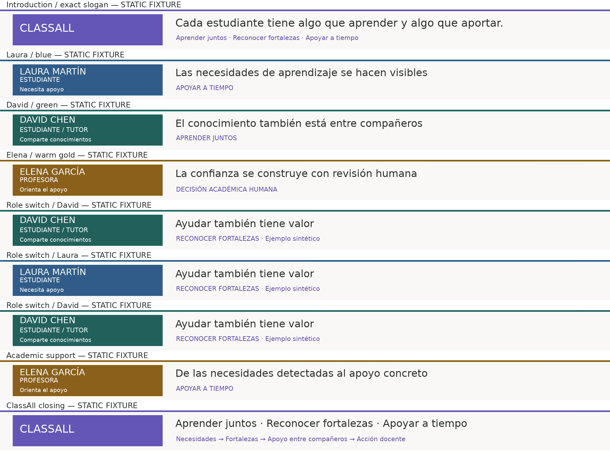

# ClassAll V2.1 QA — 5 November 2026

## Delivery status

**Renderer and documentation implemented; production rendering and footage review will run locally against the user's existing Windows take.** The exact original Cloud path `/workspace/classall/work/video-v2/take-TrSYmU/` was checked and is absent in this session. The user confirmed a successful nine-scene Windows take at `C:\Users\TimHu\OneDrive\Dokumente\GitHub\classall\work\video-v2\take-lkSmHc\`, with persisted-state verification passed there. Its media and database are not accessible here. Per the user's instruction, implementation proceeds without rerecording or requiring an archive. The static test export is explicitly a fixture and is not delivered as the ClassAll film.

The shell's Git fetch could not connect to its configured proxy. The GitHub app supplied the exact V2 source files. Changes are limited to new V2.1 editorial files, this documentation and the production guide. No application functionality, original V2 renderer/configuration, recording scripts or approved narration changes.

## Measured checks

Linux FFmpeg **7.1.5**, Python **3.12.14**, DejaVu Sans. Windows itself was not executed.

| Check | Result |
|---|---|
| Existing V2 editorial safety tests | 4 passed |
| New V2.1 regression tests | 6 passed: timing/WAV preservation, role mapping, contrast, failed-assembly preservation, isolated audio errors, overlong voice rejection |
| Full nine-scene fixture encode | 179.000000 seconds; 5370 frames; H.264/yuv420p; 1920×1080; 30/1 fps; one video stream; no audio |
| Full fixture decode | FFmpeg null-output decode passed without reported errors |
| Source preservation | Fixture source SHA-256 unchanged after rendering |
| Audio integration | Nine 0.1-second non-speech pulse WAVs passed preflight, aligned into bounded PCM slots, and exported to a separate AAC/video file; a 20-second first segment was rejected as overlong; silent master preserved |
| Contrast | White identity text: violet 6.24:1, blue 6.69:1, green 6.50:1, gold 5.53:1 |
| Text fit | All nine main messages fit the 1328 px available width with the tested font; slogan ~1033 px at 34 px |
| Aspect ratio | Source must be 16:9; output footage 1696×954 = exactly 16:9 |
| Original files | V1/V2 renderers, configuration, recordings and narration unchanged in the remote patch; no database writes |

Fixture silent SHA-256: `81aa99fe29cffb5c54ba13551f3821e996ce9ce733b4f262a93ac73c97a1986d`. This identifies the **static screenshot test**, not a production master. It has a permanent on-screen fixture label. The source is an existing English frontend screenshot, not the approved Spanish interaction recording. Synthetic role-switch events test the renderer only; they do not verify production persona timing.

## Visual checkpoints actually inspected

Reviewed the rendered introduction and a contact sheet of the band showing the introduction, Laura, David, Elena, David → Laura → David, academic-support message and final ClassAll composition. Slogan, Spanish accents, names, roles, concept lines and principal messages were legible with no observed clipping. The band is 30 px taller than V2 and more prominent through a solid identity panel and role-colored rule.





The user explicitly authorized these two small demonstration previews in PR #7. They contain synthetic demonstration content only. No private data, databases or video files are included.

The comparison reconstructs V2's unchanged band with its original renderer text/layout on the same fixture. It is a band-design comparison, not a comparison of the original two films. No complete human screening is claimed.

Still pending on the approved take: all real-role transitions, cursor and click readability after scaling, readable controls/results, original persisted-state re-verification, actual nine-scene footage review, production output measurement/hash, laptop screening and final human narration review.

## Windows compatibility and reproduction

V2.1 passes the filter graph as one argument to the long-established `-filter_complex` option via Python's argument list, with no shell. It **does not invoke `-filter_complex_script`** or the newer `-/filter_complex` syntax. UTF-8 Spanish text is read from generated text files. A copy of each graph remains in `v2-1-filter-NN.txt` for diagnosis. A conservative 30,000-character graph guard fails clearly for unusually fragmented recordings before Windows' command-line limit is reached.

No new minimum FFmpeg version is imposed relative to V2's existing filters. A full build must expose the required filters, ffprobe and libx264; the renderer checks capabilities rather than assuming a version string proves support. Tested here only with FFmpeg 7.1.5 on Linux. The user's installed Windows build remains untested; use these checks first. Custom-font metrics also require a local frame review.

Run from the repository root in PowerShell. **Reuse the existing V2 take; do not run the recorder.** The take needs `raw/scene-01.webm`…`scene-09.webm`, `recording.json` and `state-qa.json`; preserve its database and original masters too. If moving an archived take, use its new absolute path instead of a stale `latest.txt` path.

```powershell
git switch feature/classall-demo-video
git pull --ff-only origin feature/classall-demo-video
python --version
ffmpeg -version
ffprobe -version
ffmpeg -hide_banner -filters | Select-String 'drawtext|drawbox|scale|pad|concat|tpad|fade'
ffmpeg -hide_banner -encoders | Select-String libx264
$py = (Resolve-Path .venv\Scripts\python.exe).Path
$take = 'C:\Users\TimHu\OneDrive\Dokumente\GitHub\classall\work\video-v2\take-lkSmHc'
if (-not (Test-Path (Join-Path $take 'recording.json'))) { throw 'Select the original successful V2 take' }
& $py scripts\video\test_v2.py
if ($LASTEXITCODE -ne 0) { throw 'V2 tests failed' }
& $py scripts\video\test_v2_1.py
if ($LASTEXITCODE -ne 0) { throw 'V2.1 tests failed' }
& $py scripts\video\verify.py (Join-Path $take 'database\classall-v5-presentation.sqlite3') $take
if ($LASTEXITCODE -ne 0) { throw 'Original take state verification failed' }
& $py scripts\video\render_v2_1.py $take
if ($LASTEXITCODE -ne 0) { throw 'V2.1 render failed; original masters retained' }
$master = Join-Path $take 'final\classall-demo-v2-1-silent.mp4'
ffprobe -v error -show_streams -show_format $master
ffmpeg -v error -i $master -f null -
if ($LASTEXITCODE -ne 0) { throw 'Decode failed' }
Get-FileHash $master -Algorithm SHA256
Start-Process $master
```

If the existing virtual environment is unavailable, recreate it using the unchanged setup in `VIDEO_PRODUCTION.md`. Rendering itself uses Python's standard library and local FFmpeg, with no browser, paid service or new package. Do not use Python `-O`, since the established workflow uses assertions for validation.

After the first complete V2.1 render, `--scene 4` rerenders that scene and reassembles; `--assemble-only` reuses its edited clips. Rerender all nine scenes after global band/font/renderer changes. V2.1 clips use `edited/v2-1-scene-NN.mp4`; the manifest and timing snapshot end in `-v2-1.json`. Successful pending files replace only their V2.1 targets after validation.

```powershell
& $py scripts\video\render_v2_1.py $take --scene 4
if ($LASTEXITCODE -ne 0) { throw 'Scene render failed' }
& $py scripts\video\render_v2_1.py $take --assemble-only
if ($LASTEXITCODE -ne 0) { throw 'Assembly failed' }
& $py scripts\video\render_v2_1.py $take --audio work\team-voice-v2 --check-audio
if ($LASTEXITCODE -ne 0) { throw 'Check audio-preflight-v2-1.json' }
& $py scripts\video\render_v2_1.py $take --audio work\team-voice-v2
if ($LASTEXITCODE -ne 0) { throw 'Voice import failed' }
```

Use the same approved nine human WAV files and offsets as V2. Voiced output is `final/classall-demo-v2-1-voiced.mp4`; aligned files live in `audio-v2-1/`. No speech or music is synthesized. Test pulses were used solely for technical verification and are not part of the silent film.

The chat output directory could not be created because `/codex` is read-only in this environment. The two explicitly authorized labeled visual comparisons are included in the documentation; test MP4s remain under ignored `work/v2-1-qa/`. No large media is committed. PR #7 remains open; no merge is part of this workflow.
